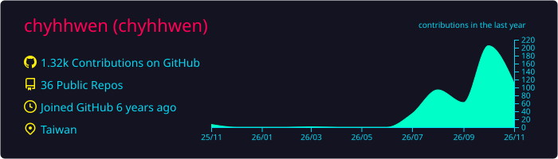
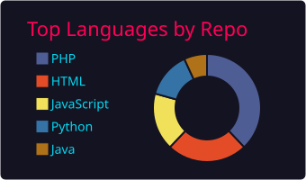
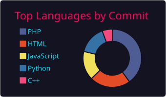
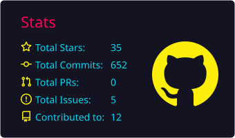
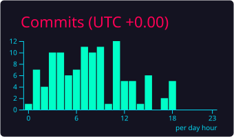

# 小赤
- 🔭 I’m currently working on deep-learning
- 🌱 I’m currently learning java
- 👯 I’m looking to collaborate on Dogsbody
- 📫 How to reach me: xiaochyh@gmail.com
- 
  

- 
  
 
- 
 

-   

***

 
 
